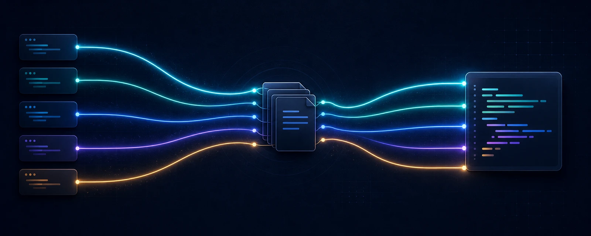

<div align="center">

# omp-flow

**把调查、设计、实现与独立复核沉淀为项目本地、Git 可追踪的知识。**

中文 · [English](README_EN.md)

[](https://www.npmjs.com/package/omp-flow)
[](https://github.com/Andyduck-ops/omp-flow)
[](LICENSE)



<sub>任务知识留在 Git 可见的 Markdown 中；模型、原生 Agent、并发与 UI 留在你的 Harness 中。</sub>

</div>

## 快速开始

全局安装 CLI：

```bash
npm install -g omp-flow@latest
```

进入项目并初始化。`-u` 只设置当前仓库的 Git `user.name`：

```bash
cd <your-project>
omp-flow init -u "Your Name"
```

以后更新全局 CLI 和项目内受管文件：

```bash
npm install -g omp-flow@latest
cd <your-project>
omp-flow update
```

建议先预览：

```bash
omp-flow update --dry-run
```

`--dry-run` 只打印计划，不写文件。计划中的 `new` 会创建新模板，`autoUpdate` 表示项目副本
仍等于上次安装版本、可以安全升级，`unchanged` 会跳过；`changed` 表示项目副本已经有本地
差异，默认询问覆盖、保留或另存为 `.new`。如果希望保留全部本地差异，同时继续创建 `new`
并执行 `autoUpdate`，使用：

```bash
omp-flow update --skip-all
```

只要计划会写文件，更新前会把现有受管文件备份到 `.omp-flow/.backup-<timestamp>/`。
Task Bundle、Wiki 中的用户内容，以及运行时数据都不是模板覆盖目标。被用户主动删除的
受管文件会保持删除，除非显式选择重新创建；但如果某个已选 Harness 的受管文件全部缺失（例如
`.claude/` 被忽略或没有随仓库带过来），计划会标为 `restore` 并整组恢复。`--force`
会覆盖所有 `changed` 文件，不建议作为日常更新命令。
安装和更新会在写入前检查受管目标路径，拒绝链接目录或非普通文件目标；另存为 `.new`
时也检查实际的新文件路径。出现路径冲突时先修正项目目录，不要用 `--force` 绕过。

无交互环境才需要 `--omp`、`--codex`、`--claude`、`--snow` 或 `--cursor`；日常使用不必记这些参数。

### 0.7.0 更新

- **Sleep 改为 Dreaming，不再排队等人审**：归档后 Sleep 直接把新提炼的知识以 `draft` 写入
  `.omp-flow/wiki/`，修复断链，并在 `.omp-flow/sleep/runs/` 留下收据。不改 `wiki/specs/`，不改已归档
  Task，也不给自己的产出升格。Finish 把这次运行单独提交，一次 `git revert` 即可撤销。
- **开局注入有界**：根 `wiki/index.md` 只列领域摘要；可选的 `wiki/brief.md`（不超过 2,000 字符）在
  五个 Harness 开局注入，只能链接运行前已是 `stable`/`accepted` 的 Concept。路由 Skill 与各张地图整张
  注入，不再截断；Claude 把它们各作为一段注入，避开 10,000 字符的预览限制。
- **索引保留手写 frontmatter**：`index` 不再覆盖领域 `index.md` 的多行 frontmatter；未写 `status`
  的页面不显示徽标；新增 Wiki 诊断（断链等）。`wiki/specs/index.md` 只在初始化时创建，不再被模板覆盖。
- **`update` 能整组恢复缺失的 Harness**：某个已选 Harness 的受管文件全部缺失时（例如 `.claude/`
  被忽略），计划标为 `restore` 并整组恢复。
- **`omp-flow-ui-designer`** 改为教一套可持续的 UI 设计方法，而不是清单。
- **升级提示**：`sleep finish` 的 `--candidate` 改为 `--wiki`，描述符升为 `ompFlowSleep` v2；
  `.omp-flow/sleep/candidates/` 不再使用，其中仍有价值的内容可手动移入 Wiki 并标 `draft`。`update`
  会提示删除已退役的 `disposition.py`。

### 0.6.0 更新

- **少打扰人**：只在决定属于人、而人还没做出时才停下来问，例如价值或范围取舍、QbD 校准、blocker
  路由、Spec 晋升，以及没人要求过的高风险操作。请求里已经要求的事直接做；Work 内的修复会自动进行，
  最多三轮，每轮由不同 actor 复核。
- **新增两个 Skill**：`omp-flow-adr` 在 `.omp-flow/wiki/decisions/` 中记录决策（以 MADR 4.0.0 为基础），
  `omp-flow-restate` 在动手前用自己的话复述人的目的、完成状态和限制（依据 teach-back、指挥官意图等
  沟通方法）。Wiki 支持按日期和原因归档到 `.omp-flow/wiki/archive/`。
- **开局地图不再丢失**：Claude Code 会把超过 10,000 字符的 Hook 上下文存成文件、只给模型 2,000 字符
  预览。现在三张地图共用 9,000 字符预算，超长时截断并给出文件路径，不再整张丢弃。
- **派发更简单**：`actorId` 是主会话起的可读名字，不再要求等于 Harness 原生 id；共享 Skill 给出每个
  role 对应的各 Harness agent。Claude 的 agent 定义只禁用 `Agent` 工具，其余工具（包括 MCP）照常继承。
- **升级提示**：如果你改过 `.claude/settings.json`，`update` 会保留你的版本；请手动删除其中指向
  `inject-agent-identity.py` 的 `SubagentStart` 配置。

### 从 0.4.x 升级到 0.5.0

`0.5.0` 完成 Task-first WorkScope 切换。每个需要 Task 的命令都必须明确打开一个 Task 与工作区：

```bash
npm install -g omp-flow@0.5.0
cd <your-project>
omp-flow update
omp-flow task open <task> --workspace <path>
omp-flow task show <task> --workspace <path>
```

`--workspace` 省略时使用当前仓库；需要替换现有 WorkScope 标记时显式添加 `--replace`。
更新会备份并仅在模板哈希仍匹配时移除已退役的 `active_task.py`；本地改过的旧文件会报告冲突并保留，需手工处理。Task Bundle、Wiki、运行时数据和用户自有指令文件不会被迁移覆盖。
operation descriptor 仍为 v1；模型判断、执行成功和 receipt 完成也不等于人工批准。

## omp-flow 做什么

omp-flow 为多 Agent 开发提供可移植的方法与很小的机械内核，同时保留每个 Harness 的原生执行体验。

| 边界 | 所有者 | 职责 |
| --- | --- | --- |
| Task Bundle 与 Concepts | Git 可追踪的 Markdown | 保存问题、来源、需求、设计、决定、工作、交接与复核 |
| `.omp-flow` Python runtime | omp-flow | 只保证 session、路径、actor、锁、原子操作和不透明 receipt |
| 原生执行 | 你的 Harness | 继续负责模型、Agent 派发、并发、进度、取消、隔离与 UI |

因此，omp-flow 不会把 Markdown 解析成生命周期数据库，也不会接管平台的模型或调度系统。

## 支持的 Harness

| Harness | 项目本地集成 |
| --- | --- |
| Oh My Pi | 扩展、原生 Agent、Skills 与设置 |
| Codex | 原生 Agent、Hooks 与共享 Skills |
| Claude Code | 原生 Agent、Hooks、Skills 与设置 |
| Snow | 原生 Agent、Hooks 与共享 Skills |
| Cursor | 原生 Agent、Hooks 与共享 Skills |

初始化只安装你选择的集成；任务知识仍是一套可移植的 Bundle。

## 工作流概览

```text
brainstorm ↔ research → design → QbD → work map → QbD → implementation → review → finish
```

这是一条推理方向，不是 runtime phase state。证据可以让工作回到 framing 或 design；实现结果也必须经过不同 actor 的独立复核。完整语义见 [Workflow index](templates/.omp-flow/workflow/index.md)。

### 按需代码布局（0.5.2）

代码场景可以按需读取 `.omp-flow/workflow/code/` 下的作业布局：

- [How](templates/.omp-flow/workflow/code/how.md)：理解子系统职责、数据归属与实际运行路径。
- [Why](templates/.omp-flow/workflow/code/why.md)：从代码锚点追溯历史证据、约束与取舍。
- [Architect](templates/.omp-flow/workflow/code/architect.md)：先写调用者用例，再推导数据结构和接口。
- [Interrogate](templates/.omp-flow/workflow/code/interrogate.md)：独立检查具体失败路径、已排除风险与验证缺口。

Research、Design、Check Skills 只保留触发条件与路径索引，不预加载全部布局。
布局复用当前分派的 Concept；小节可以按任务调整，不是新的 Workflow、固定文档 schema
或批准门。`init` 和 `update` 为所有选定 Harness 安装这些布局，沿用现有的本地修改保护。


## 项目知识与文档系统

omp-flow 把不同生命周期和可信度的知识分开放置，但全部保持为普通 Markdown：

| 位置 | 用途 | 边界 |
| --- | --- | --- |
| `.omp-flow/tasks/<task>/` | 当前任务的问题、来源、需求、设计、决定、交接与复核 | 属于一个具体 Task Bundle；完成后可归档 |
| `.omp-flow/wiki/` | 跨任务复用的架构、约定、经验与项目事实 | 只保存已有证据支持、值得长期维护的知识 |
| `.omp-flow/wiki/decisions/` | 架构与设计决策记录：背景、备选方案、结果与验证方式 | 文件名为 `领域--问题--日期.md`；高风险或有歧义的决策需人确认 |
| `.omp-flow/wiki/brief.md` | 可选的跨任务简报（不超过 2,000 字符），开局注入 | 只写具体的反默认结论，并链接已是 `stable`/`accepted` 的 Concept；由 Sleep 或人写入 |
| `.omp-flow/sleep/runs/` | 每次归档后 Dreaming 运行的收据：核验、修改、跳过与上报了什么 | 只作审计记录；知识本身在 Wiki |

`omp-flow init` 和 `omp-flow update` 会安装并维护这些目录所需的模板、Skills 与运行时。

### 开局地图注入

各平台通过原生会话 Hook 注入 `omp-flow` 路由 Skill（主会话在每条路线都遵守的规则）和三张地图：
`.omp-flow/tasks/index.md`、`.omp-flow/wiki/index.md`（只列 `## Domains` 领域摘要）、
`.omp-flow/workflow/index.md`，存在时再附可选的 `.omp-flow/wiki/brief.md`；打开的 Task 只注入其 index
路径指针。Codex、Claude
在启动、clear 和 compact 时注入（恢复和 fork 会带回原对话，不重复注入）；OMP 支持会话开始及压缩后的
下一次模型调用，Snow/Cursor 使用原生会话开始事件。
地图只提供导航和普通 Markdown 链接；
模型应先认真阅读地图，再按当前问题选择需要的 Concept，不需要把整个 Task 或 Wiki 历史
一次性载入上下文。路由 Skill 和每张地图都整张注入，不截断；Claude Code 只给单段超过 10,000 字符的
注入 2,000 字符预览，所以 Claude 把它们各作为一段注入。缺失或无法读取时
明确显示 unavailable，不会制造替代状态。完成持久性工作后，Agent 应检查 Task/Wiki index 是否仍能找到最新 handoff、Review 和
恢复入口。


每个 Markdown Concept 顶部的 YAML Frontmatter（`type`、`title`、`description`、`tags`、可选 `status`）是各级 `index.md` 的唯一真源；运行 `omp-flow index [all|wiki|tasks|<task>]`（以及在 `task create`、`operation finish`、`task archive` 时自动触发）即可从文档自身同步生成各级目录索引，并在打开局部 WorkScope 时额外给出当前任务的 `Active Task index` 路径。完整设计原理见 [知识架构与自维护设计原理](docs/knowledge-architecture.md)。
任务完成并归档后，Sleep 对那个精确的 Git checkpoint 做一遍轻量 Dreaming：只核对与本任务直接
相关的 1–3 篇 Wiki Concept，把新提炼的知识以 `[draft]` 写入 `.omp-flow/wiki/`，修复诊断报告的
断链，并在 `.omp-flow/sleep/runs/` 留下收据；没有新内容时走零改动快路径。它不读取原始 Harness
transcript，不用向量聚类，不碰 `wiki/specs/`，也不给自己的产出升格：`draft` 只有经不同执行体
核验后才升为 `stable`。Finish 把这次运行单独提交，一次 `git revert` 即可撤销。

```text
Task Bundle → finish（提交 1）→ archive（提交 2）→ Sleep Dreaming（提交 3）
                                                    └→ wiki [draft] ──异体核验──→ stable
```

`0.5.0` 同时更新了共享 Workflow Skills 与各 Harness 的原生 Agent 指令，使 Brainstorm、
Research、Design、QbD、Implementation、Review 和 Finish 更强调实践证据、独立复核、
可恢复 assignment，以及人类决定与模型判断之间的边界。

## 致谢

- [pi-maestro-flow](https://github.com/catlog22/pi-maestro-flow/blob/089f067ca669b90de7b80b38251ae3d9dfddad98/README.md) 启发了公开 README 的呈现方式。
- [superpowers](https://github.com/obra/superpowers) 启发了有条件的停点、先查后问与修复循环。
- [MADR](https://github.com/adr/madr) 是决策记录格式的基础。

## 许可证

omp-flow 采用 [MIT License](LICENSE)，版权声明为 `Copyright (c) 2026 Andyduck-ops`。

## 友情链接

[Linux DO](https://linux.do/)
