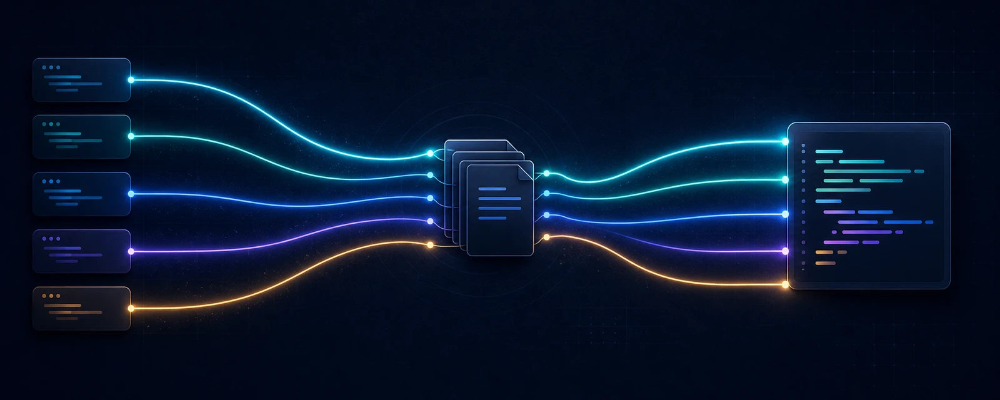

<div align="center">

# omp-flow

**Turn research, design, implementation, and independent review into project-local, Git-tracked knowledge.**

[中文](README.md) · English

[](https://www.npmjs.com/package/omp-flow)
[](https://github.com/Andyduck-ops/omp-flow)
[](LICENSE)



<sub>Task knowledge stays in Git-visible Markdown; models, native agents, concurrency, and UI stay in your Harness.</sub>

</div>

## Quick start

Install the CLI globally:

```bash
npm install -g omp-flow@latest
```

Enter your project and initialize it. `-u` sets Git `user.name` for this repository only:

```bash
cd <your-project>
omp-flow init -u "Your Name"
```

Later, update the global CLI and the managed project files:

```bash
npm install -g omp-flow@latest
cd <your-project>
omp-flow update
```

Preview the plan first:

```bash
omp-flow update --dry-run
```

`--dry-run` prints the plan without writing files. `new` creates a newly managed template;
`autoUpdate` means the project copy still matches the previously installed version and can be
safely upgraded; `unchanged` is skipped. `changed` means the project copy has local differences,
so the CLI asks whether to overwrite it, keep it, or save the new template as `.new`. To preserve
all local differences while still applying `new` and `autoUpdate` entries, use:

```bash
omp-flow update --skip-all
```

Before a plan writes files, omp-flow backs up existing managed files under
`.omp-flow/.backup-<timestamp>/`. Task Bundles, Wiki user content, and runtime data are not
template-overwrite targets. User-deleted managed files remain deleted unless explicitly recreated. When every managed file of a
selected Harness is missing (for example an ignored or uncloned `.claude/`), the plan marks them
`restore` and recreates the whole set.
`--force` overwrites every `changed`
file and is not recommended for routine updates.
Installation and update preflight managed write destinations and reject linked ancestors or
non-ordinary targets, including the actual `.new` destination. Correct the project paths when
a conflict is reported; `--force` does not bypass destination checks.

Only non-interactive environments need `--omp`, `--codex`, `--claude`, `--snow`, or `--cursor`; ordinary use does not.

### What's new in 0.7.0

- **Sleep becomes Dreaming, with no human review queue:** after archive, Sleep writes newly
  distilled knowledge straight into `.omp-flow/wiki/` as `draft`, repairs broken links, and leaves a
  receipt under `.omp-flow/sleep/runs/`. It never edits `wiki/specs/` or the archived Task and never
  promotes its own output. Finish commits the run on its own, so one `git revert` undoes it.
- **Bounded session start:** the root `wiki/index.md` lists domains only. An optional
  `wiki/brief.md` (at most 2,000 characters) is injected by all five Harnesses and may link only
  Concepts that were `stable`/`accepted` before the run. The Router Skill and every map are injected
  whole; Claude receives each as its own part, staying under the 10,000-character preview limit.
- **Indexes keep authored frontmatter:** `index` no longer overwrites multi-line frontmatter in
  domain `index.md` files, pages without `status` show no badge, and Wiki diagnostics report broken
  links. `wiki/specs/index.md` is created once at init and no longer overwritten by templates.
- **`update` restores a missing Harness:** when every managed file of a selected Harness is gone
  (for example an ignored `.claude/`), the plan marks it `restore` and recreates the set.
- **`omp-flow-ui-designer`** now teaches a durable UI design method instead of a checklist.
- **Upgrade note:** `sleep finish` takes `--wiki` instead of `--candidate`, and the descriptor is
  `ompFlowSleep` v2. `.omp-flow/sleep/candidates/` is no longer used; move anything still useful into
  the Wiki as `draft` by hand. `update` offers to remove the retired `disposition.py`.

### What's new in 0.6.0

- **Less interruption:** agents stop only for a decision that belongs to the human and is not yet
  made, such as value or scope trade-offs, QbD calibration, blocker routing, Spec promotion, and
  high-risk effects nobody asked for. What the request already asks for is done. Repair inside a
  Work runs on its own for at most three rounds, each re-reviewed by a different actor.
- **Two new Skills:** `omp-flow-adr` keeps decision records in `.omp-flow/wiki/decisions/` (based on
  MADR 4.0.0), and `omp-flow-restate` restates the human's purpose, end state, and limits before work
  starts (based on teach-back, commander's intent, and related methods). The Wiki can archive
  Concepts by date and reason under `.omp-flow/wiki/archive/`.
- **Session maps no longer vanish:** Claude Code moves hook context over 10,000 characters into a
  file and shows the model a 2,000-character preview. The three maps now share a 9,000-character
  budget; a long map is cut with a pointer to its file instead of being dropped.
- **Simpler dispatch:** `actorId` is a readable name Main chooses and need not equal a Harness id;
  the shared Skill maps each role to each Harness's agent. Claude agent definitions deny only the
  `Agent` tool and inherit every other tool, MCP tools included.
- **Upgrade note:** if you customized `.claude/settings.json`, `update` keeps your copy; remove its
  `SubagentStart` entry that points to `inject-agent-identity.py` by hand.

### Upgrading from 0.4.x to 0.5.0

`0.5.0` completes the Task-first WorkScope cutover. Commands that operate on a Task require an
explicitly opened Task and workspace:

```bash
npm install -g omp-flow@0.5.0
cd <your-project>
omp-flow update
omp-flow task open <task> --workspace <path>
omp-flow task show <task> --workspace <path>
```

Omit `--workspace` to use the current repository; add `--replace` only when intentionally replacing
an existing WorkScope marker. Update backs up and removes the retired `active_task.py` only when its
template hash still matches. Customized legacy files are reported and preserved for manual cleanup.
Task Bundles, Wiki, runtime data, and user-owned instruction files are never migration-overwrite
targets. The operation descriptor remains v1; model PASS, executor success, and receipt completion
do not constitute human approval.

## What omp-flow does

omp-flow provides a portable method and a small mechanical kernel for multi-agent development while preserving each Harness's native execution experience.

| Boundary | Owner | Responsibility |
| --- | --- | --- |
| Task Bundles and Concepts | Git-tracked Markdown | Preserve questions, sources, requirements, designs, decisions, work, handoffs, and reviews |
| `.omp-flow` Python runtime | omp-flow | Guarantee only sessions, paths, actors, locks, atomic operations, and opaque receipts |
| Native execution | Your Harness | Continue to own models, agent dispatch, concurrency, progress, cancellation, isolation, and UI |

Accordingly, omp-flow neither parses Markdown into a lifecycle database nor takes over a platform's model or scheduling system.

## Supported Harnesses

| Harness | Project-local integration |
| --- | --- |
| Oh My Pi | Extension, native agents, Skills, and settings |
| Codex | Native agents, Hooks, and shared Skills |
| Claude Code | Native agents, Hooks, Skills, and settings |
| Snow | Native agents, Hooks, and shared Skills |
| Cursor | Native agents, Hooks, and shared Skills |

Initialization installs only the integrations you select; task knowledge remains one portable Bundle.

## Workflow at a glance

```text
brainstorm ↔ research → design → QbD → work map → QbD → implementation → review → finish
```

This is a reasoning direction, not runtime phase state. Evidence can return work to framing or design, and implementation results still require independent review by a different actor. See the [Workflow index](templates/.omp-flow/workflow/index.md) for the complete semantics.

### On-demand code layouts (0.5.2)

For code-specific work, read the matching recipe under `.omp-flow/workflow/code/`:

- [How](templates/.omp-flow/workflow/code/how.md): subsystem responsibilities, data ownership, and actual execution paths.
- [Why](templates/.omp-flow/workflow/code/why.md): code anchors, historical evidence, constraints, and tradeoffs.
- [Architect](templates/.omp-flow/workflow/code/architect.md): caller examples before data structures and interfaces.
- [Interrogate](templates/.omp-flow/workflow/code/interrogate.md): independent failure-path review, cleared risks, and verification gaps.

The Research, Design, and Check Skills contain only trigger/path indexes; they do not preload every
layout. Reuse the assigned Concept and adapt suggested sections to the task. Layouts are not new
Workflows, fixed document schemas, or approval gates. `init` and `update` install them for every
selected Harness using the existing local-customization protection.


## Project knowledge and documentation

omp-flow separates knowledge with different lifetimes and confidence levels while keeping all of it as ordinary Markdown:

| Location | Purpose | Boundary |
| --- | --- | --- |
| `.omp-flow/tasks/<task>/` | The current task's problem, sources, requirements, design, decisions, handoffs, and reviews | Belongs to one Task Bundle and can be archived after completion |
| `.omp-flow/wiki/` | Reusable architecture, conventions, experience, and project facts | Keeps evidenced knowledge worth maintaining across tasks |
| `.omp-flow/wiki/decisions/` | Architecture and design decision records: context, options, outcome, and how to confirm it | Named `context--question--date.md`; high-risk or ambiguous decisions need human confirmation |
| `.omp-flow/wiki/brief.md` | Optional cross-task brief (at most 2,000 characters) injected at session start | Only concrete counter-default conclusions linking a `stable`/`accepted` Concept; written by Sleep or a human |
| `.omp-flow/sleep/runs/` | One receipt per post-archive Dreaming run: what was checked, changed, skipped, or escalated | Audit trail only; the Wiki holds the knowledge |

`omp-flow init` and `omp-flow update` install and maintain the templates, Skills, and runtime needed by these directories.

Native session hooks inject the `omp-flow` Router Skill (Main's working rules on every route) and
three maps: `.omp-flow/tasks/index.md`, `.omp-flow/wiki/index.md` (only a `## Domains` summary),
and `.omp-flow/workflow/index.md`, plus the optional `.omp-flow/wiki/brief.md` when present. An open
Task contributes only a path pointer to its index.
Codex and Claude cover startup, clear, and compact; resume and fork bring back the original
conversation, so they are not injected again.
OMP reloads on session start and after compaction; Snow and Cursor use their native session-start event.
Follow useful links relative to each index. The Router and every map are injected whole, never cut.
Claude Code previews only 2,000 characters of a single injection over 10,000, so Claude injects each
as its own part. Missing, invalid UTF-8, or escaping paths are reported as
unavailable. Maps do not grant approval or select a Task.


Each Markdown Concept's YAML frontmatter (`type`, `title`, `description`, `tags`, and optional `status`) serves as the single source of truth for directory navigation; running `omp-flow index [all|wiki|tasks|<task>]` (or automatic triggers on `task create`, `operation finish`, and `task archive`) regenerates hierarchical `index.md` maps and adds a pointer to the active Task's index when a local WorkScope is open. See [Knowledge Architecture & Self-Maintaining Index](docs/knowledge-architecture.md) for the design rationale.
After a completed Task is archived, Sleep runs one lean Dreaming pass over that exact Git checkpoint. It checks the 1–3 Wiki Concepts the Task touches, writes newly distilled knowledge into `.omp-flow/wiki/` as `[draft]`, repairs reported broken links, and leaves a receipt under `.omp-flow/sleep/runs/`. When nothing is new it takes the zero-edit fast path. It does not read raw Harness transcripts, use vector clustering, touch `wiki/specs/`, or promote its own work: a `draft` becomes `stable` only after a different actor verifies it. Finish commits the run separately, so one `git revert` undoes it.

```text
Task Bundle → finish (commit 1) → archive (commit 2) → Sleep Dreaming (commit 3)
                                                        └→ wiki [draft] ──different-actor check──→ stable
```

`0.5.0` also updates the shared Workflow Skills and Harness-native Agent instructions so Brainstorm, Research, Design, QbD, Implementation, Review, and Finish more clearly preserve practice evidence, independent review, recoverable assignments, and the boundary between human decisions and model judgment.

## Credits

- [pi-maestro-flow](https://github.com/catlog22/pi-maestro-flow/blob/089f067ca669b90de7b80b38251ae3d9dfddad98/README.md) inspired the public README presentation.
- [superpowers](https://github.com/obra/superpowers) informed the conditional stop rules, look-before-you-ask, and the repair loop.
- [MADR](https://github.com/adr/madr) is the basis of the decision record format.

## License

omp-flow is available under the [MIT License](LICENSE) with `Copyright (c) 2026 Andyduck-ops`.

## Friendly links

[Linux DO](https://linux.do/)
