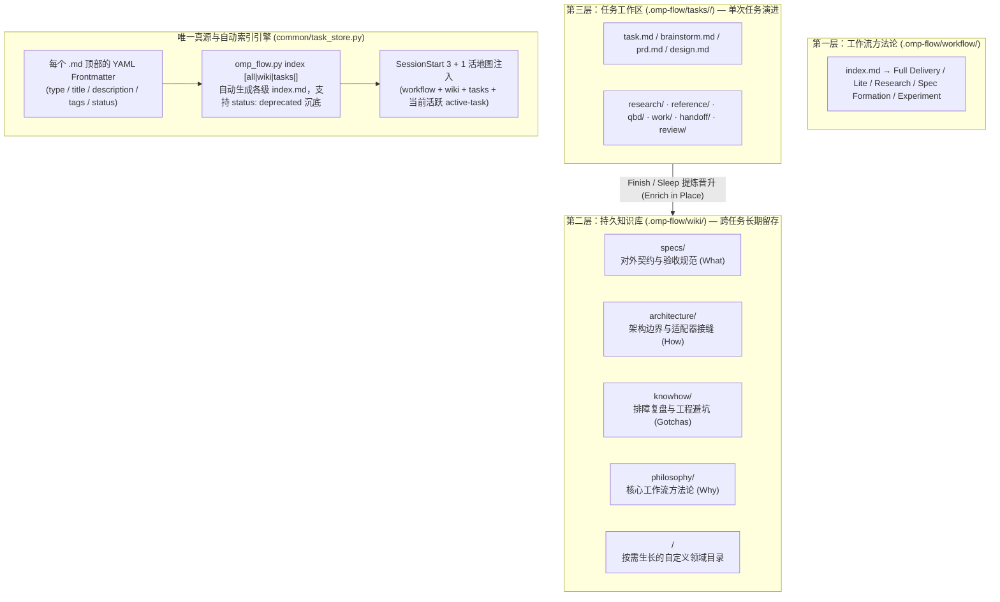

# omp-flow 知识架构与自维护设计原理 (Knowledge Architecture & Self-Maintaining Index)

本文档阐述 `omp-flow` 为什么采用 **「三层文化结构（Workflow / Wiki / Tasks）+ 唯一真源 Frontmatter + 脚本化自动索引 + 原地更新（Edit-in-Place）」** 的知识管理设计，以及它如何融合 **Google Open Knowledge Format (OKF v0.2)** 与 **OpenSpec** 的核心优势。

---

## 1. 核心痛点：为什么 Agent 维护的文档库容易腐化？

在多轮、多子 Agent 协作的工程任务中，传统的纯手写 Markdown 文档库通常会遇到三个结构性退化问题：

1. **双真源失步（Dual-Source Drift）**：每新建或修改一个文档，若要求 AI 同时手工编辑文档自身和外层的 `index.md`（甚至祖父级 `index.md`），AI 极易漏更外层索引，或把标题、摘要改得前后不一致。
2. **平铺式追加膨胀（Append-Only Bloat）**：当设计、实现或审查发生迭代时，AI 出于惰性往往倾向于新建 `design-v2.md`、`review-reaudit.md`、`repaired-control.md`，导致同一个 Task 目录下堆积大量过时草稿，后续会话连哪个文件代表最终真相都无法分辨。
3. **封闭分类与自由失序的两难**：如果完全不分类，文档全堆在同一目录很快沦为垃圾场；如果把分类枚举写死在校验器里，遇到性能压测（`benchmarks/`）、线上故障复盘（`runbooks/`）等新场景时又会触发报错。

---

## 2. 架构解法：融合 Google OKF v0.2 与 OpenSpec

`omp-flow` 从 **Google Cloud Platform 官方 OKF v0.2 (`open-knowledge-format`)** 与 **Fission-AI `OpenSpec`** 中分别吸取了互补的两大支柱：



### 2.1 向 Google OKF v0.2 借鉴：Frontmatter 唯一真源 + 脚本化生成 `index.md`

在 Google 官方 OKF v0.2 参考实现（`bundle/index.py`）中，**Agent 从不手工编辑任何 `index.md`**。
`omp-flow` 完整落地了这一原则：

- **唯一真源（Single Source of Truth）**：每个 Markdown Concept 文件顶部的 YAML Frontmatter 承载自身完整的导航元数据：
  ```yaml
  ---
  type: "Diagnostic Knowhow"
  title: "OMP 非交互模式 (-p) 的 stdin EOF 与超时边界"
  description: "调用 omp -p 执行非交互任务时必须显式闭合 stdin (< /dev/null) 并使用单一外层 timeout。"
  tags: ["omp", "cli", "stdin", "timeout"]
  status: "stable" # 可选：draft | stable | deprecated
  ---
  ```
- **开放集 `type` + 灵活 `tags`**：
  - `type` 提供默认推荐值（如 `Task`、`Research`、`Design`、`Work`、`Handoff`、`Review`、`Spec`、`Architecture`、`Knowhow`、`Philosophy`），但**绝不锁死枚举**——写入自定义 `type`（如 `Benchmark`、`Runbook`）或在 `wiki/`、`tasks/<task>/` 下新建任意自定义子目录时，索引器会自动识别并为其生成分组与子目录 `index.md`。
  - `tags` 允许横向打标（如 `[cli, tty, regression]`），解决单一树状目录无法表达跨领域关联的问题。
- **脚本化自动汇总（`omp_flow.py index`）**：
  - 在 `task create`、`operation finish`、`task archive` 时，Python 内核自动重算对应 Task Bundle 的 `index.md` 与顶层 `.omp-flow/tasks/index.md`。
  - 随时可执行 `omp-flow index [all|wiki|tasks|<task>]`（或 `python3 -X utf8 .omp-flow/scripts/omp_flow.py index all`），一键递归扫描 `.omp-flow/wiki/` 与 `.omp-flow/tasks/`，自下而上生成所有子目录与根目录 `index.md`。
  - 当某个旧文档标记为 `status: "deprecated"` 时，脚本会自动将其移入 `index.md` 底部的 `## Deprecated` 折叠区，既保留历史追溯，又不污染主干导航。

### 2.2 向 OpenSpec 借鉴：双区隔离 + 原地修订铁律（Edit-in-Place）

1. **双区隔离（持久真源库 vs. 演进工作区）**：
   - `.omp-flow/wiki/` 是跨任务共享的持久真源库，按职责分为四大默认领域：
     - `specs/`：**系统承诺什么（What must be true）**——经独立审查与人类批准的产品/协议/验证契约。
     - `architecture/`：**系统怎么划分边界（How it is structured）**——模块权责、Harness 适配器与运行时接缝。
     - `knowhow/`：**踩过什么坑、怎么排查（What goes wrong）**——根因复盘、环境雷区、回归防护套路。
     - `philosophy/`：**为什么这样设计（Why we work this way）**——第一性原理与工作流演进取舍。
   - `.omp-flow/tasks/<task>/` 是单次任务的演进工作区（Bundle），允许探索、假设与试错。
2. **原地修订铁律（Enrich-First / Edit-in-Place）**：
   - **在 Task 内部**：同一决策、同一设计、同一工作项或同一审查发生返工时，**直接原地更新对应的 `design.md`、`work/<item>.md`、`handoff/<item>.md`、`review/<item>.md`**（由 Git 历史负责保留差异），严禁堆叠 `-v2`、`-reaudit`、`-repaired` 等重复文件。
   - **在 Finish / Wiki 晋升时**：对照 `.omp-flow/wiki/index.md`，若已有同主题文档则优先原地 `Enrich` 更新其正文与 Frontmatter；仅当确认属于全新独立概念时才新建文件。

---

## 3. SessionStart「3 + 1」活地图动态注入

为了消除「AI 忘了维护或忘了查阅某张地图」的断层，所有受支持的 Harness（Oh My Pi、Codex、Claude Code、Snow、Cursor）在会话启动（`SessionStart` / `before_agent_start`）时，都会自动动态读取并注入**最多 4 张活地图（3 + 1）**：

1. **Wiki 地图**：`.omp-flow/wiki/index.md`（持久知识全景与各领域条目摘要）
2. **Task 地图**：`.omp-flow/tasks/index.md`（活跃与近期任务列表、标签及一句话目标）
3. **Workflow 地图**：`.omp-flow/workflow/index.md`（按需选择的交付与研究路线）
4. **Active Task 地图（+1）**：若当前工作区存在合法的 `.omp-flow/.runtime/workscope.json`，自动附带注入当前打开任务的 `.omp-flow/tasks/<active-task>/index.md`！

通过 **「Frontmatter 唯一真源 → Python 脚本自动生成 `index.md` → 会话启动 3+1 动态注入」** 的闭环，人类与 Agent 只需专注编写高质量的单个 Markdown Concept，全仓导航永远保持最新、零漂移、零手工同步负担。
